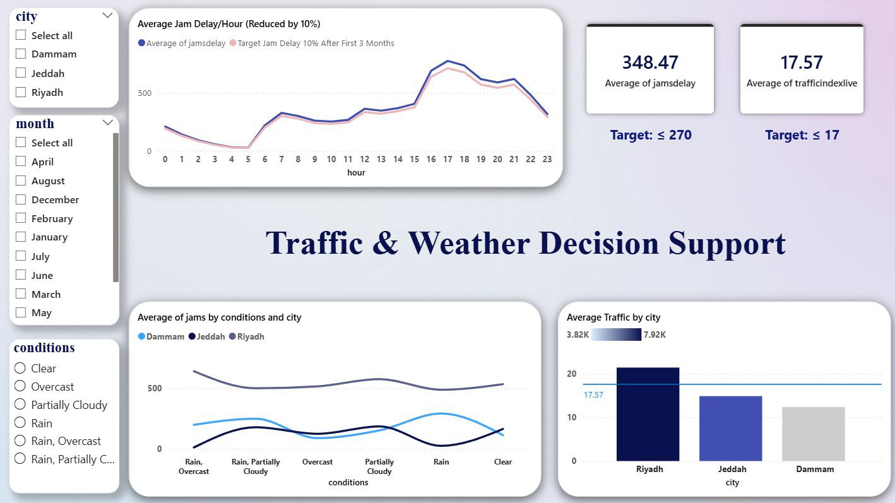
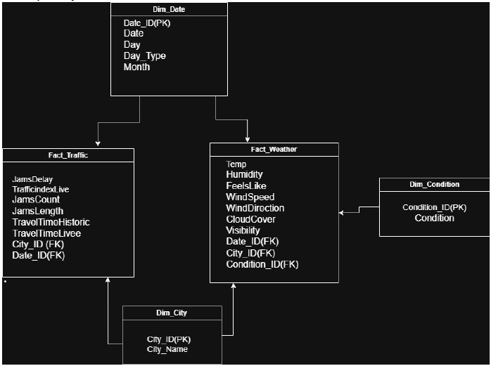

# Traffic and Weather Data Analysis for Decision Support

An end-to-end data project on traffic congestion in Riyadh, Jeddah and Dammam. Two messy datasets on traffic and weather were cleaned and merged in Python, modelled as a star schema, and turned into a Power BI decision-support dashboard with clear KPIs and targets.

Built as a team project for **MIS 350: Decision Support Systems and Expert Systems** at King Saud University.



## The problem

Traffic congestion in Saudi Arabia's three largest cities changes a lot by time of day and by weather. High temperatures, rain and low visibility can all affect traffic flow and road safety. The traffic and weather data sit in separate datasets, but they share city and datetime. Combining them lets decision-makers see how weather affects congestion and plan better traffic management.

## The data

| Stage | File | Rows | Columns |
|---|---|---|---|
| Before | `traffic_dataset.xlsx` | 16,100 | 11 |
| Before | `weather_dataset.xlsx` | 16,100 | 12 |
| After | Merged fact table | 15,603 | 24 |

Both datasets hold hourly readings for Riyadh, Jeddah and Dammam during 2023. Each file has a `ColumnDescription` sheet that defines every column.

### Data quality problems

| Problem | Example |
|---|---|
| Missing values | About 42 missing readings in each traffic measure |
| Duplicate rows | 12 exact duplicates in the traffic data |
| Impossible values | 61 rows with a negative traffic index |
| Extreme outliers | A traffic index as high as 2,000 on a scale that normally stays under 60 |
| Inconsistent dates | Dates that do not match the main `MM/DD/YY HH:MM` format |
| Inconsistent labels | City names written several ways, such as `riyadh` and `ruh`, `Jeddah` and `Jed` |

## Process

### 1. Extract
Load the traffic and weather Excel files into Python with pandas.

### 2. Transform
The traffic cleaning code is in [`notebooks/01_clean_traffic_data.ipynb`](notebooks/01_clean_traffic_data.ipynb).

- Remove rows with missing values and duplicate records.
- Remove negative values and extreme outliers.
- Convert the datetime column to one standard format.
- Add new features: year, month, hour and time of day.
- Standardise column names and categorical values such as city names and day types.
- Merge the traffic and weather data into one fact table on city and datetime.

### 3. Model
Each dataset was first modelled as its own star schema, then combined into one integrated model. Traffic and weather facts share the date and city dimensions.



### 4. Load and analyse
The merged table was loaded into Power BI to build the dashboard.

## KPIs

| KPI | Question it answers | Baseline and target |
|---|---|---|
| Average jam delay by hour | At what hours does traffic delay peak? | First three months are the baseline. Target is 10% lower from month four. Hours above 500 seconds are flagged. |
| Average jam delay by weather and city | Which weather causes the worst delays, and where? | Clear weather is the baseline. Anything 20% above it is flagged. |
| Average traffic index by city | Which city is the most congested? | Overall average is 17.57. Target is below 17 for every city. |
| Average jam delay | Are delays within an acceptable range? | Overall average is 348.47 seconds. Target is 270 or less. Above 420 is flagged. |
| Average traffic index | How congested are the roads on average? | Overall average is 17.57. Target is 17. Above 20 is flagged. |

## Dashboard

The Power BI report, [`dashboard/traffic-weather-dashboard.pbix`](dashboard/traffic-weather-dashboard.pbix), is a one-page decision-support view. It has slicers for city, month and weather condition, two KPI cards with targets, and three charts: jam delay by hour against the 10% reduction target, jams by weather condition and city, and traffic index by city.

Open the file with the free [Power BI Desktop](https://www.microsoft.com/power-platform/products/power-bi/desktop).

## Key findings

- **Late afternoon is the worst time to drive.** Jam delay peaks between 4 pm and 5 pm.
- **Riyadh is the most congested city.** Its traffic index (21.4) is 73% higher than Dammam's (12.4).
- **Riyadh has the highest delays in every weather condition.**
- **Riyadh Season adds travel time.** From October to December, average travel time was 73.3 minutes, against a historical baseline of 70.6 minutes.
- **Overall, delays are above target.** Average jam delay is 348.47 seconds against a target of 270.

## Recommendations

1. Introduce flexible work hours in Riyadh. Staggering end times by 60 to 90 minutes could ease the weekday evening peak.
2. Prioritise road infrastructure and public transport investment in Riyadh.
3. Build weather into traffic planning, with early warnings and proactive management when bad weather is forecast.
4. Increase traffic monitoring during peak hours.

## My role

I was responsible for:
- Defining the problem and writing the dataset overview
- Designing the traffic and weather star schemas and the integrated model
- The ETL process: cleaning and merging the datasets in Python
- Defining the KPIs
- Building the Power BI dashboard, with teammates
- Dividing tasks across the team, and contributing to the final report and presentation

## Tools

Python (pandas, NumPy) · Google Colab · Excel · Power BI · dimensional modelling

## Repository structure

```
saudi-traffic-weather-analysis/
├── README.md
├── data/raw/                        Original traffic and weather datasets
├── notebooks/
│   └── 01_clean_traffic_data.ipynb  Traffic cleaning and feature engineering
├── dashboard/
│   └── traffic-weather-dashboard.pbix
├── images/                          Dashboard screenshot and star schema
└── docs/
    └── analysis-report.pdf          Final report: problem, KPIs, schema, ETL, recommendations
```

## Running the notebook

The notebook was written for Google Colab. Open it in Colab, run the cells in order, and upload `data/raw/traffic_dataset.xlsx` when asked.

## Team

Team project with Layan Alfadhel, Rama Alowlah, Manar Almousa and Ruyuf Alsayari.
